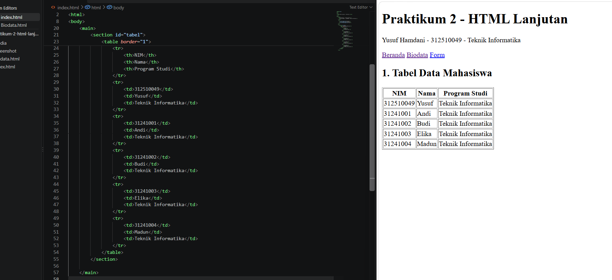
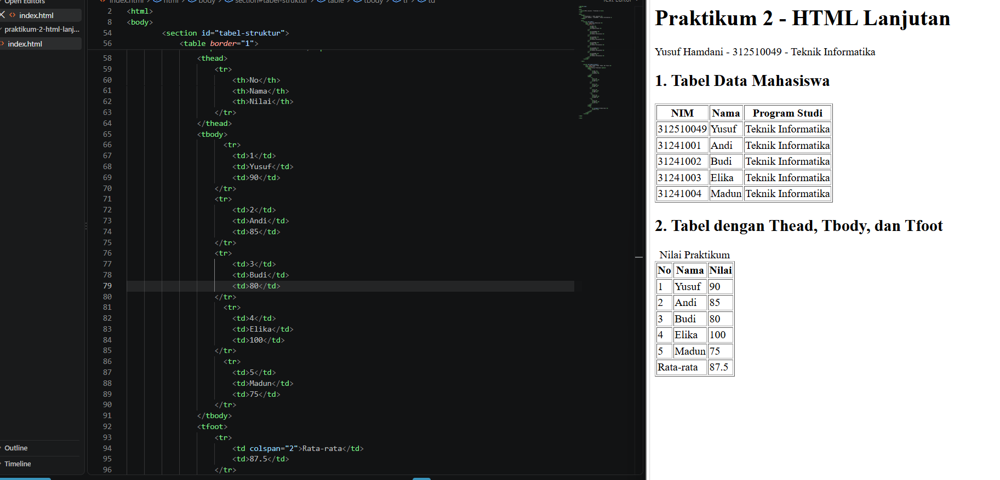
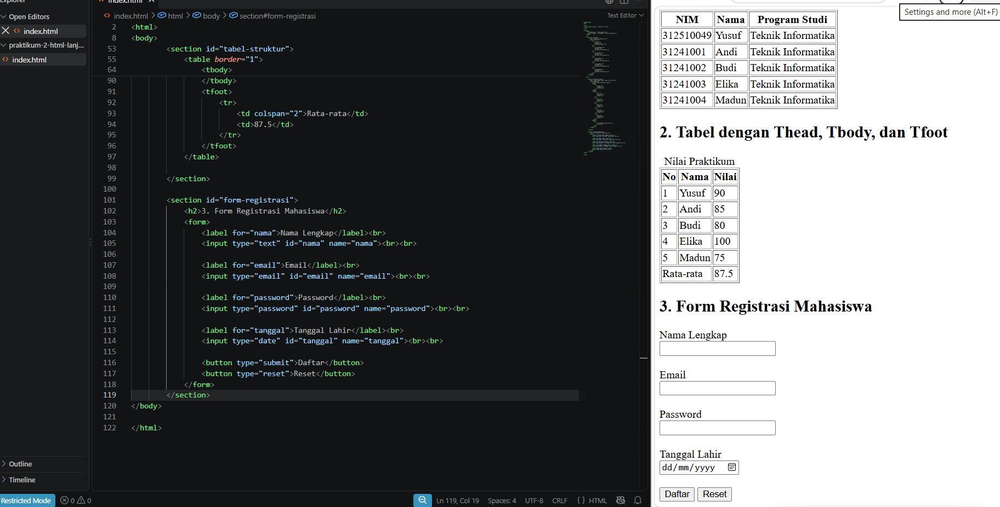
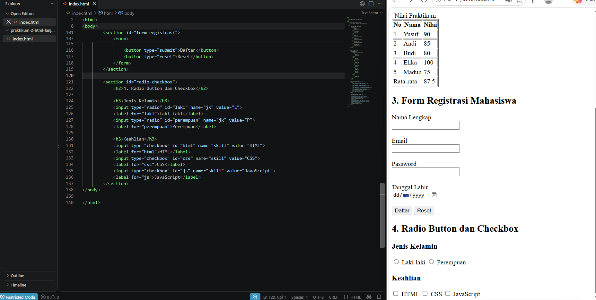
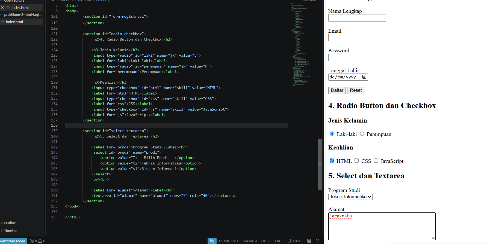
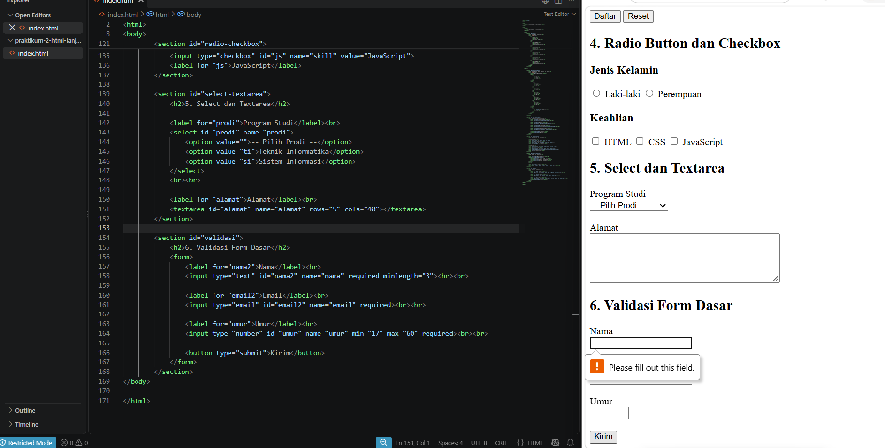
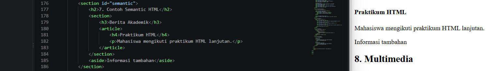
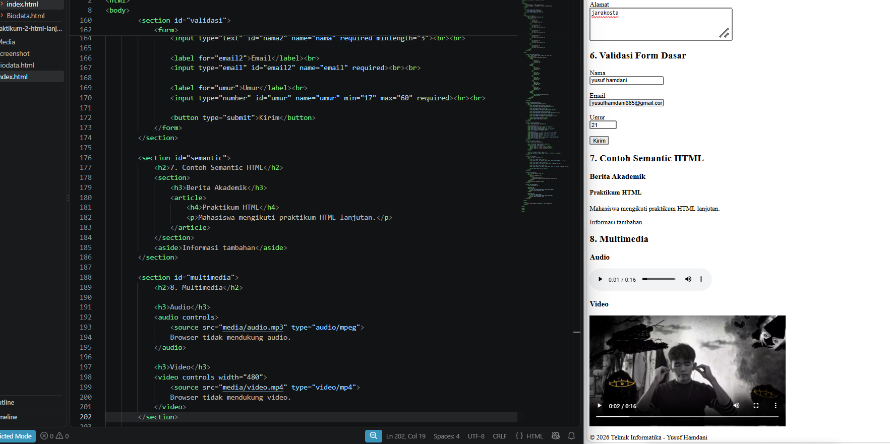
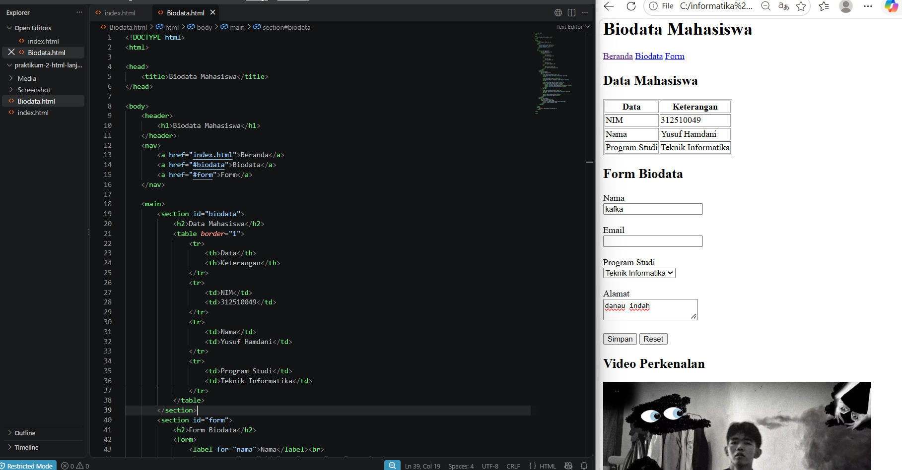

# Praktikum 2 – HTML Lanjutan

## Identitas Mahasiswa

**Nama:** Yusuf Hamdani
**NIM:** 312510049
**Program Studi:** Teknik Informatika

---

## 1. Tujuan Praktikum

Praktikum ini bertujuan agar mahasiswa mampu memahami dan menerapkan tabel, form dengan berbagai jenis input, semantic HTML, elemen multimedia, serta validasi form dasar pada HTML.

---

## 2. Alat yang Digunakan

* Visual Studio Code
* Web Browser
* GitHub

---

## 3. Langkah-Langkah Praktikum

### 3.1 Membuat Tabel Data Mahasiswa

Langkah pertama adalah membuat tabel sederhana menggunakan elemen `<table>`, `<tr>`, `<th>`, dan `<td>` untuk menampilkan data NIM, Nama, dan Program Studi dari tiga mahasiswa.

Contoh penggunaan tabel dasar:

```html
<table border="1">
    <tr>
        <th>NIM</th>
        <th>Nama</th>
        <th>Program Studi</th>
    </tr>
    <tr>
        <td>312510049</td>
        <td>Yusuf Hamdani</td>
        <td>Teknik Informatika</td>
    </tr>
</table>
```



---

### 3.2 Mengembangkan Tabel dengan Thead, Tbody, dan Tfoot

Tabel kedua ("Nilai Praktikum") dikembangkan menggunakan `<caption>`, `<thead>`, `<tbody>`, dan `<tfoot>` agar data lebih terstruktur, dengan baris rata-rata ditampilkan di bagian footer menggunakan `colspan`.

Contoh penggunaan thead, tbody, dan tfoot:

```html
<table border="1">
    <caption>Nilai Praktikum</caption>
    <thead>
        <tr><th>No</th><th>Nama</th><th>Nilai</th></tr>
    </thead>
    <tbody>
        <tr><td>1</td><td>Andi</td><td>85</td></tr>
        <tr><td>2</td><td>Budi</td><td>90</td></tr>
    </tbody>
    <tfoot>
        <tr><td colspan="2">Rata-rata</td><td>87.5</td></tr>
    </tfoot>
</table>
```



---

### 3.3 Membuat Form Registrasi Mahasiswa

Form registrasi dibuat dengan input `text`, `email`, `password`, dan `date`, dilengkapi `<label>` yang terhubung ke tiap input melalui atribut `for`, serta tombol `submit` dan `reset`.

Contoh penggunaan form registrasi:

```html
<form>
    <label for="nama">Nama Lengkap</label><br>
    <input type="text" id="nama" name="nama"><br><br>

    <label for="tanggal">Tanggal Lahir</label><br>
    <input type="date" id="tanggal" name="tanggal"><br><br>

    <button type="submit">Daftar</button>
    <button type="reset">Reset</button>
</form>
```



---

### 3.4 Radio Button dan Checkbox

Bagian Jenis Kelamin menggunakan `radio button` (satu pilihan) dan bagian Keahlian menggunakan `checkbox` (bisa lebih dari satu pilihan).

Contoh penggunaan radio button dan checkbox:

```html
<input type="radio" id="laki" name="jk" value="L">
<label for="laki">Laki-laki</label>
<input type="radio" id="perempuan" name="jk" value="P">
<label for="perempuan">Perempuan</label>

<input type="checkbox" id="html" name="skill" value="HTML">
<label for="html">HTML</label>
```



---

### 3.5 Select dan Textarea

Program Studi dipilih menggunakan elemen `<select>` dengan beberapa `<option>`, sedangkan Alamat menggunakan `<textarea>` untuk input teks multi-baris.

Contoh penggunaan select dan textarea:

```html
<select id="prodi" name="prodi">
    <option value="ti">Teknik Informatika</option>
    <option value="si">Sistem Informasi</option>
</select>

<textarea id="alamat" name="alamat" rows="5" cols="40"></textarea>
```



---

### 3.6 Validasi Form Dasar

Validasi diterapkan menggunakan atribut `required`, `minlength`, `min`, dan `max` pada input nama, email, dan umur, sehingga form tidak bisa dikirim jika data belum sesuai ketentuan.

Contoh penggunaan validasi form:

```html
<input type="text" id="nama2" name="nama" required minlength="3">
<input type="email" id="email2" name="email" required>
<input type="number" id="umur" name="umur" min="17" max="60" required>
```



---

### 3.7 Membuat Contoh Semantic HTML

Struktur halaman disusun menggunakan elemen semantic `<header>`, `<nav>`, `<main>`, `<section>`, `<article>`, `<aside>`, dan `<footer>`, termasuk contoh bersarang `<section>` berisi `<article>` dan `<aside>`, agar struktur halaman lebih bermakna dibanding hanya menggunakan `<div>`.

Contoh penggunaan semantic HTML:

```html
<section>
    <h3>Berita Akademik</h3>
    <article>
        <h4>Praktikum HTML</h4>
        <p>Mahasiswa mengikuti praktikum HTML lanjutan.</p>
    </article>
</section>
<aside>Informasi tambahan</aside>
```



---

### 3.8 Menambahkan Multimedia

Elemen `<audio>` dan `<video>` ditambahkan dengan atribut `controls` serta elemen `<source>` untuk memutar berkas suara dan video.

Contoh penggunaan audio dan video:

```html
<audio controls>
    <source src="media/audio.mp3" type="audio/mpeg">
</audio>

<video controls width="480">
    <source src="media/video.mp4" type="video/mp4">
</video>
```



---

### 3.9 Proyek Mini – Biodata Mahasiswa

Seluruh materi digabungkan pada `biodata.html`: semantic structure, tabel data diri, form dengan validasi dasar, dan satu elemen multimedia (video). Halaman ini dijalankan melalui web browser sebagai hasil akhir proyek mini.



---

## 4. Hasil Praktikum

Hasil dari praktikum ini adalah dua halaman web:

* **index.html** — latihan tabel, form, radio/checkbox, select/textarea, validasi, semantic HTML, dan multimedia.
* **biodata.html** — proyek mini biodata mahasiswa yang menggabungkan tabel, form bervalidasi, semantic structure, dan multimedia.

Elemen HTML yang digunakan meliputi:

* `<table>`, `<tr>`, `<th>`, `<td>`, `<caption>`, `<thead>`, `<tbody>`, `<tfoot>`
* `<form>`, `<label>`, `<input>` (text, email, password, date, number, radio, checkbox)
* `<select>`, `<option>`, `<textarea>`, `<button>`
* `<header>`, `<nav>`, `<main>`, `<section>`, `<article>`, `<aside>`, `<footer>`
* `<audio>`, `<video>`, `<source>`

---

## 5. Jawaban Pertanyaan

**1. Apa fungsi `<table>`, `<tr>`, `<th>`, dan `<td>`?**
`<table>` membungkus seluruh struktur tabel, `<tr>` membuat satu baris, `<th>` membuat sel header, dan `<td>` membuat sel data.

**2. Apa perbedaan `<th>` dan `<td>`?**
`<th>` digunakan untuk sel header dan tampil tebal serta rata tengah secara default, sedangkan `<td>` digunakan untuk sel data biasa dengan teks rata kiri.

**3. Apa fungsi `colspan` pada tabel?**
`colspan` menggabungkan beberapa kolom menjadi satu sel, misalnya untuk menampilkan label "Rata-rata" yang melebar menutupi beberapa kolom sekaligus.

**4. Apa fungsi `<form>` dalam HTML?**
`<form>` membungkus elemen-elemen input agar data yang dimasukkan pengguna dapat dikumpulkan dan dikirim untuk diproses lebih lanjut.

**5. Apa perbedaan radio button dan checkbox?**
Radio button hanya memperbolehkan satu pilihan dari sekelompok opsi dengan `name` yang sama, sedangkan checkbox memperbolehkan satu atau beberapa pilihan sekaligus.

**6. Mengapa `<label>` sebaiknya terhubung dengan id input melalui atribut `for`?**
Agar label bisa diklik untuk langsung mengaktifkan/fokus ke input terkait, serta meningkatkan aksesibilitas bagi pengguna screen reader dan perangkat sentuh.

**7. Apa perbedaan `<textarea>` dengan input type text?**
`<textarea>` digunakan untuk teks panjang multi-baris dengan ukuran yang bisa diatur lewat `rows`/`cols`, sedangkan `input type="text"` hanya untuk teks pendek satu baris.

**8. Apa fungsi semantic HTML seperti `<header>`, `<nav>`, `<main>`, `<section>`, `<article>`, `<aside>`, dan `<footer>`?**
Memberi makna struktural pada tiap bagian halaman sehingga lebih mudah dipahami oleh pengembang maupun mesin seperti search engine dan screen reader, dibanding hanya memakai `<div>` generik.

**9. Apa fungsi `required`, `min`, `max`, dan `minlength`?**
`required` membuat input wajib diisi, `min` dan `max` membatasi nilai minimum/maksimum (angka atau tanggal), dan `minlength` membatasi jumlah karakter minimum pada input teks.

**10. Apa perbedaan elemen `<audio>` dan `<video>`?**
`<audio>` khusus memutar berkas suara, sedangkan `<video>` memutar berkas video lengkap dengan gambar dan suara; keduanya mendukung atribut `controls` dan elemen `<source>`.

---

## 6. Kesimpulan

Pada Praktikum 2 HTML Lanjutan, telah dipelajari penggunaan tabel, form dengan berbagai jenis input, semantic HTML, elemen multimedia, serta validasi form dasar. Seluruh materi diterapkan pada `index.html` sebagai latihan dan `biodata.html` sebagai proyek mini yang menggabungkan semua elemen tersebut dalam satu halaman biodata mahasiswa.

---

## 7. Repository GitHub

Repository praktikum ini dibuat menggunakan GitHub dengan nama **Lab2Web**, berisi struktur berikut:

```
Lab2Web/
├── index.html
├── biodata.html
├── media/
│   ├── audio.mp3
│   └── video.mp4
├── Screenshot/
│   ├── ss1.png
│   ├── ss2.png
│   ├── ss3.png
│   ├── ss4.png
│   ├── ss5.png
│   ├── ss6.png
│   ├── ss7.png
│   ├── ss8.png
│   └── ss9.png
└── README.md
```